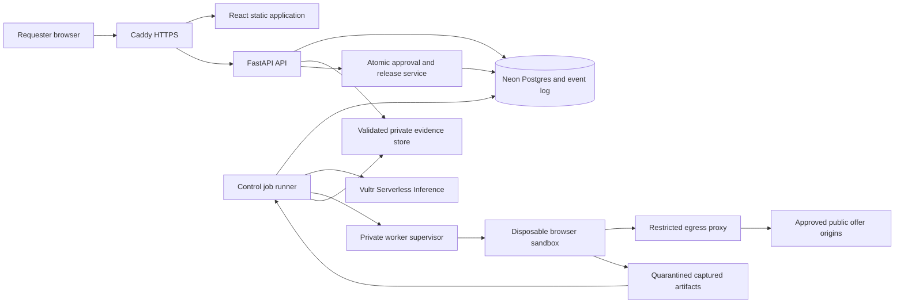

# Latch architecture and implementation contract

Version 2, November 4, 2026. The user authorizes implementation and commits per verified step. Provider independent work may proceed while live Vultr gates are deferred. Application storage uses the supplied Neon Postgres database. Source capture, model review and release remain gated on real evidence. The product name is Latch; QuoteProof appears only in retained research history.

Read this document first, then [the implementation roadmap](docs/IMPLEMENTATION.md), [data and API contracts](docs/CONTRACTS.md), [visual specification](docs/DESIGN.md), [security and operations](docs/SECURITY.md) and [live acceptance plan](docs/ACCEPTANCE.md). [COPY.json](COPY.json), [DESIGN_TOKENS.json](DESIGN_TOKENS.json) and [DESIGN_ROLLS.json](DESIGN_ROLLS.json) are authoritative planning assets. An implementation may tighten a limit but must not silently weaken a product/security invariant.

## 1. Outcome and truthful boundaries

Latch lets a requester inspect up to three supplier offers for a small IT equipment rollout, review the source terms, choose a complete feasible basket, approve one version and recheck those sources before an internal release record is created. The output is a decision packet a person can hand to procurement. Release is not a supplier order, payment, stock reservation, price lock or legal certification.

The initial user is an IT deployment coordinator sourcing specified equipment from accessible supplier pages. This is a buyer hypothesis, not a claimed customer. The first feasibility gate must establish a real supported task; if actual work requires private PDF/email/portal flows, either explicitly redesign scope or stop this direction. Do not build a polished fictional procurement desk and call it validation.

Hackathon direction: Blast Radius Zero, browser execution pattern. The control plane and web deployment are on Vultr, all agent LLM calls use Vultr Serverless Inference, and browser work occurs in disposable isolated execution on Vultr. The event accepts one or both execution patterns. Generated code is unnecessary for these arithmetic rules and is excluded. [Official challenge](https://lablab.ai/ai-hackathons/vultr-hackathon)

There is no justified blockchain component. The earlier generic dapp/testnet wording does not establish a chain requirement for this procurement product. Live acceptance means actual Vultr inference, actual isolated navigation to supported supplier sources, actual authenticated review and real durable internal records over HTTPS. Do not add a wallet or token only to claim a network transaction.

**No simulated product success:** do not ship seeded purchases, synthetic supplier pages, mocked API responses, fixed winning offers, artificial progress or prerecorded captures as a live workflow. The old synthetic examples remain historical research only. Real isolated adversarial probes may exercise enforcement with no financial/external effect; label those as security tests. They are not buyer evidence or the normal demonstration. No fake login, successful-release animation without a committed record, or frontend fallback to local sample data.

## 2. Scope and required features

Core supports one requester account, request revision history, up to three items with exact reviewed specifications, up to three approved supplier origins/profiles, one currencyUSD, one selected supplier, integer quantities, explicit pack/MOQ, explicit tax-inclusive price, shipping and stated delivery. Public no-login HTML offers with at most one approved terms page each are the initial format. A source is supported only after a profile and a real source have passed the network/content checks. Empty UI is truthful until real data exists.

The project must provide:

1. Human sign-in with durable, revocable sessions and owner-scoped authorization. No public registration/email flow is required; provision named evaluation accounts securely.
2. Request worksheet, explicit saved drafts, request version conflict detection and configurable requester timezone.
3. Bounded agent/browser inspection, source snapshots, actual status events and ownership-protected evidence access.
4. Proposed term extraction with visible evidence, per-field review, corrections with reasons and unresolved-term handling.
5. Deterministic complete-basket normalization and eligibility. No model-authored totals/status.
6. Selection only among complete feasible reviewed offers; explicit explanation when none qualify.
7. Approval bound to immutable request/comparison/source/policy versions and requester identity.
8. Fresh all-source recapture on release, material diff, expiry checks and an atomic idempotent internal record.
9. A readable versioned receipt, source manifest and downloadable packet with accurate confidentiality/retention behavior.
10. Distinctive responsive workbench, accessible evidence review, light/dark/system theme, real vector identity and complete state/error design.
11. Actual Vultr deployment, public entry plus protected workspace, real end-to-end evidence, finite adversarial containment evidence and recovery procedures.

Out of scope: supplier discovery across arbitrary web, CAPTCHA/login bypass, vendor email, file import/OCR, private signed URLs, variable tax/FX, multi-supplier optimization, product substitutions, supplier checkout, payments, ERP, team role administration, self-modifying/generated code, model training, autonomous changes to buyer policy and a blockchain ledger.

## 3. Nonnegotiable invariants

I1 Every query, file and SSE stream is owner-authorized on the server; an unguessable ID is not authorization.

I2 Model/page content can suggest terms and public navigation only. It cannot approve, release, alter budget/deadline, mark human review, choose execution flags or control filesystem/network permissions.

I3 A missing required line produces `complete_total_cents=null`. Known quoted subtotal is separately labeled. Unknown is never zero. Incomplete is distinct from infeasible.

I4 Every decision-critical field comes with source evidence or an explicit requester-supplied assertion. Critical unknown, conflict or unsupported interpretation blocks readiness. Human confirmation is attributed, not treated as supplier authenticity.

I5 No mutable record can silently change the meaning of an approval. Request, source-set, policy, extraction, correction or selected-offer changes invalidate it.

I6 Every source used in a comparison is rechecked before release, including rejected suppliers. Unavailable/partial/changed sources stop that release. The requester can remove a source only by creating/reviewing a new version.

I7 All recapture intervals used for release must finish no more than60 seconds before the server commit; approval expires after 10 minutes. A fresh capture does not guarantee future supplier terms. Clock anomalies fail closed.

I8 Approval/recheck validation and internal release creation occur in one short database transaction with uniqueness constraints. A lost response must be recoverable without duplicate release.

I9 No task container receives keys, user session/CSRF tokens, buyer identity/budget, host paths, Docker socket or infrastructure authority. User browser credentials and server-to-model authentication are different trust zones.

I10 Failures, reviews, abstentions and unverified facts remain visible in evaluation; no synthetic fallback or fabricated observability.

I11 Frontend copy, titles, accessible names and README use human prose, no emoji/em dash/unnecessary hyphen. Supplier/user source punctuation remains intact as evidence.

I12 Authorized commits use solely dotmantissa <negativemantissa@gmail.com> as author and committer, with no coauthor trailer. Public deployment and submission require separate authorization.

## 4. Stack decisions and version policy

| Layer | Decision | Implementation rule |
| --- | --- | --- |
| Frontend | React, TypeScript strict, Vite | Use Node 24 supported LTS and a compatible current stable Vite/React; pin exact versions and lock dependencies in the first implementation pass. The current shell's Node 20 must not be assumed sufficient. |
| Routing | React Router declarative routes | Real route history/deep links; protected loader redirects; request state from API, never a fake local data store |
| Server state | TanStack Query | Query keys include user/request/version. Native EventSource only for truthful job status; refetch authoritative resource after terminal event |
| Styling | Plain CSS variables/modules, small accessible primitives | No component-kit appearance. Use Radix Dialog/Select where necessary, style to tokens, native controls where clearer |
| Icons | lucide-react | Explicit imports, verify installed exports, accessible labels, no Unicode substitutes |
| API | Python 3.13, FastAPI, Pydantic 2 | HTTP schemas and strict domain models own contracts; generate frontend types from OpenAPI, do not hand-maintain divergent schemas |
| Model client | HTTPX to Vultr chat endpoint | Explicit request timeout, schema validation, token/step limit and usage accounting; no other provider fallback |
| Control job runner | Separate Python process | Claims Postgres jobs via leases and row locks; no FastAPI in-process background task for durable work |
| Store | Neon Postgres, dedicated latch schema | Pooled application connections over TLS, direct transactional migrations, numbered checksums, foreign keys and immutable version triggers |
| Worker | Private supervisor plus pinned browser image | Non-root Chromium, compatible seccomp/gVisor policy, no Docker runtime control from app/model; pinned Playwright package/browser/image versions |
| Gateway | Caddy | Same-origin frontend/API/SSE and public automatic HTTPS with persistent certificate storage |
| Artifacts | Local encrypted persistent volume | App-owned ACL routes; no public bucket, no permanent signed URLs, consented retention and safe export |
| Tests | pytest, real Playwright browser, axe, contract checks | Domain invariants and real-service acceptance. Never patch network routes into successful API responses |

Implementation resolves exact supported versions from official documentation, installs them under the project, saves lockfiles and records provenance. Never claim placeholder versions were tested.

Neon connection pooling, Playwright's warnings about running untrusted pages as root, and Node's support schedule inform these gates. [Neon pooling](https://neon.com/docs/connect/connection-pooling), [Playwright container guidance](https://playwright.dev/python/docs/docker), [Node releases](https://nodejs.org/en/about/previous-releases)

## 5. Process architecture and deployment topology



Control VM initially2 vCPU/4 GiB with persistent disk; worker VM initially4 vCPU/8 GiB, one active inspection job globally. Sizes are starting assumptions pending actual plan availability and performance, not verified prices. Independent Linux users own gateway/API/runner. Private supervisor uses mTLS over a firewall-restricted private interface; TCP2375/2376 and remote CDP are never public. API/DB never reside on worker sandbox mounts.

Static frontend is built separately then served by Caddy. API binds loopback only. Control runner owns model key and restricted supervisor client credential; API needs neither. Worker supervisor owns runtime administration and a server certificate; sandbox gets neither. Proxy has allowlisted public egress only and no access to control subnet/metadata. Host firewall denies the reverse path even if the browser tampers with proxy settings.

The API never navigates or downloads supplier URLs. It validates syntax/profile references and queues work. Artifact paths are generated from server IDs and streamed through authenticated endpoints; incoming captures are untrusted until bounded type/dimension/path checks complete.

## 6. Source admission and browser plan

A source profile is an operator-reviewed configuration: allowed exact origin, explicit offer path patterns, one terms path/profile, required asset origins, content readiness condition, relevant main content region, known irrelevant chrome exclusions, capture limits and expiry. Store a profile version. An owner adding a source selects a supported profile and supplies a public offer URL that matches it. Unsupported does not automatically become an allowlist entry.

Reject usernames/passwords in URL, custom schemes/ports, IP literals unless specifically approved public source, fragments used as navigation code, signed/token-bearing queries and nonapproved redirects. Resolve/pin public addresses at the proxy connection, including IPv6 and redirect destinations; browser-side request interception is only a second check. Do not bypass robots/access controls or infer permission from a successful200.

Inspection sequence:

1. Runner loads immutable request/profile versions and a public-only item specification; excludes buyer name, budget, notes, identity and internal approval context.
2. Creates job-scoped approved URL tokens, bounded observation budget and unique worker lease/fence token. Infrastructure auth stays on trusted channels, not in task payload/environment.
3. Supervisor starts a fresh non-root browser container and disposable context for each source, with no saved cookies or authenticated state.
4. Browser navigates a server-approved token. Read DOM/page readiness with bounded waits, not `networkidle` on ad-heavy sites as an indefinite completeness guarantee. Capture fetch/redirect metadata, main/terms visible text, accessibility-derived candidate labels and lossless raster regions.
5. The model may request supported observations or permitted terms-token navigation; it cannot evaluate arbitrary JavaScript or generate Playwright code. Trusted adapter code implements every action.
6. Capture terms inclusions/exclusions as first-class content. Full required content beyond caps, collapsed essential terms, unknown price quantity basis or source contradictions mark the capture incomplete. Do not truncate and call it verified.
7. Produce a structured extraction with source-text ranges and capture/region IDs. A vision request checks image/text correspondence. It may disagree or abstain; no model-derived `approved` flag exists.
8. Validate artifact/result schema, page/profile IDs, text-span offsets, currency/units and evidence associations. Unknown fields remain unknown. Capture model calls and usage metadata with public-only prompt context.
9. Persist immutable snapshots/extraction and update derived comparison state. Destroy all contexts/containers/temporary mounts; record actual cleanup. An unsuccessful job produces a useful error and never fake quote rows.

Initial limits: two pages per supplier including terms, six pages per request,12 model decisions overall, max2schema-repair attempts without new authority,20second navigation timeout,90second source-stage watchdog,180second overall inspection deadline,10 MiB accepted raster/text artifacts per source,32 KiB extracted relevant text per page, bounded screenshot dimensions and20 KiB retained model answer. These are parameters to measure; exceeding them blocks readiness. Recheck uses identical content scope and a shorter60second overall target; if capture completion ages violate freshness at commit, release fails rather than relaxing invariants.

## 7. Content fingerprinting, semantic fields and extraction

Compute raw artifact hashes and a separate deterministic source-content fingerprint. Fingerprint covers normalized visible offer/terms text, inclusions, quantities/price basis and referenced permitted terms content, with source/profile version. Normalize Unicode toNFC, line endings and documented whitespace only. Remove dynamic text solely via fixed reviewed profile selectors; never use model summarization to decide unchanged content. Unknown/new content within the retained region changes the fingerprint.

A source may lie, hide content from a browser or change between DOM and screenshot. Hashing cannot establish truth or atomic reality. Persist capture intervals, URL chain and source claims; inconsistency blocks review readiness. Buyer review remains necessary and explicitly attributed.

Extraction schema has explicit nullable value, unit, support state, source range/capture region and ambiguity reason. Required fields: exact item match, quoted/excluded/unknown coverage, sell-unit size, minimum sell units, price per sell unit, tax basis, shipping, explicit availability for required quantity when material, delivery interpretation and expiration/conditions. No supplier total becomes authoritative until independently normalized from reviewed line terms; disagreement is shown.

Supported delivery is an explicitly interpretable latest arrival or calendar-day duration under a recorded assumed order date. Ship date is not arrival. Business-day language without a supported calendar, timezone ambiguity, quantity-dependent availability and unknown dispatch conditions require clarification. UI says Stated delivery and Estimated if ordered on the captured basis, never Guaranteed arrival.

Pydantic strict types reject booleans as numbers, negative prices, nonfinite values and unknown enum values. USD input is a validated decimal string with at most2 places, converted using Decimal to integer cents; no float rounding. Store quantities as integers1..10000, pack sizes1..10000, prices<=100000000 cents per sell unit, aggregate<=100000000000 cents; validate arithmetic bounds before frontend conversion. Never auto-convert another currency/tax regime.

## 8. Review, derived calculation and selection

Each critical field starts `extracted`, `unknown` or `disputed`. The requester opens its evidence and either confirms the proposed source value, records a source-backed correction, or requests clarification. Every review is a new immutable row referencing field version and evidence. No Confirm all shortcut. User-supplied additional facts need their own provenance and an explicit UI label; they cannot silently fill a supplier exclusion.

`buyer_checked` means a named requester reviewed that value; it is not a fact guarantee. A field edit invalidates derived comparison and approval. A request spec change invalidates all dependent item matching, not merely the total.

For each required item, compute `sell_units=max(min_sell_units,ceil(required_units/sell_unit_size))`, delivered units and extended cents. Required excluded/unknown lines produce unknown complete total; keep known quoted subtotal separately. Add explicit per-offer shipping once. In the single-tax-inclusive scope do not compute tax twice. Validate full requested availability and all stated conditions. A complete reviewed offer is feasible only if total<=budget and stated arrival<=required deadline under its recorded basis. Unknown interpretation blocks readiness; known violation yields infeasible with reasons.

Rank only complete feasible reviewed offers. Show how each rejected offer failed, without portraying incomplete subtotal as an equivalent cheaper bid. User may select among feasible candidates; if none, no approval action. Deterministic tie-break supplier ID is a presentation convenience, not a claim that tied suppliers are interchangeable. The owner still chooses.

Editing a request after any inspection creates a new request version. Existing captures/reviews stay in history; dependents are invalidated. Concurrent edits use `If-Match`/resource version checks and return conflict, never last-write-wins. Avoid broad autosave during a review/release path; explicit Save changes makes consequences clear.

## 9. Approval and release protocol

Approval payload is constructed by the server from current reviewed request/comparison versions, selected supplier, all source versions/content hashes, reviewed fields/corrections, policy/profile versions, requester ID, timestamp and expiry. Canonical JSON uses fixed integer/string/UTC representation, sorted keys and no unstable generated prose. Hash this payload. Store approval state/expiry and append an audit event in the same transaction. Requester-supplied approval hashes are checked but not trusted as authority.

Reapproval is needed for any relevant request/selection/source/extraction/correction/policy/profile change. Default approval TTL 10 minutes. Never extend it through polling. Revocation/expiration are distinct from a malicious attempt and get plain UI explanations.

Release is asynchronous because rechecking involves real network work:

1. Authenticated requester posts approved version/hash plus an idempotency key. Validate ownership/current state and create a release-attempt job/lease atomically; return 202 with attempt URL.
2. Runner fetches every decision source through the same isolated profile/content contract. This includes incomplete/late offers because new terms could change ranking. A source cannot be omitted without a new reviewed comparison.
3. Compare deterministic fingerprints and capture completeness. Changed content sets `source_changed`, stores new snapshots/diff, invalidates approval and stops. The model may explain the diff but cannot suppress it as harmless. Unavailable sources set `source_unavailable`; an unchanged earlier snapshot is not a substitute.
4. For unchanged sources, server checks all per-source captures completed no more than60 seconds ago and approval remains unexpired. Detect system-clock rollback against attempt monotonic elapsed time; an unsafe clock/lease stops commit.
5. Recompute temporal eligibility against the current proposed order/release time and stated delivery basis, even if source text is unchanged. A passed deadline or changed latest-arrival outcome blocks release and creates a new comparison requiring review. Begin a short Postgres transaction with row locks; reread owner session validity, request/comparison/policy/profile versions, approval hash/expiry, selected candidate feasibility at commit time, job fence token and immutable recheck manifest. There is no network I/O inside the transaction.
6. Insert release row with unique approval/packet identity, immutable snapshot payload and manifest; append receipt/audit/event state; mark attempt succeeded and commit. Duplicate idempotency key with identical intent returns same attempt/receipt; same key with different intent returns 409. A unique approval constraint stops different keys releasing the same approved packet twice.
7. If process dies before commit, no receipt exists; lease recovery can retry after a fresh recheck. If it dies after commit but before response, lookup returns the existing receipt. Do not restart by creating another release.

Capture time is an observed interval, not an external price lock. The supplier may change immediately after recheck. Receipt says Last checked at a precise time and Internal purchase request. Never Order placed. A fresh source image bytehash can change from rendering alone, so compare deterministic relevant content for gate; raw screenshots remain evidence. A profile may not drop unrecognized footnotes simply to reduce false changes.

## 10. Durability, jobs, events and cancellation

One control runner initially claims one runnable job via transaction, sets lease expiry/heartbeat/fence token, and records attempts. API and worker completions use job/attempt/fence IDs; stale completions are ignored but audited. Runner heartbeats every 10 seconds with30second lease, bounded extensions while active; supervisor watchdog independently enforces hard deadline. A cancelled job never mutates active comparison after its cancellation version.

API persists job/event state before returning accepted. SSE contains monotonic per-job event IDs and small safe phase payloads; authorize each stream, accept Last-Event-ID, replay persisted events, send heartbeat comments, disable gateway buffering and apply disconnect cleanup. Client reconnect/refetch is safe. No model reasoning chain or raw prompts in SSE. Terminal events trigger resource refetch, not optimistic fabricated state.

Cancellation asks supervisor to end its exact task, marks intent and waits for recorded cleanup; no success while container is still running. Navigation away does not cancel a durable job. Runner restart sweeps expired leases and reconciles containers. Supervisor restart enumerates only its labeled jobs and destroys expired orphans; never kill unrelated processes/resources. Queues do not retry infinite failures. At most one transient retry for source networking and one job recovery attempt; each retry gets fresh capture evidence and remains in history.

## 11. Human identity and privacy

Use securely provisioned named requester accounts and Argon2id password hashes; password reset is an operator-mediated, documented account action for MVP, not a fake email feature. Login has generic failure responses and per-account/IP throttling. Random32 byte session tokens reside in Secure, HttpOnly, SameSite=Lax `__Host-latch_session` cookies scoped to/with no Domain; hashed tokens inDB, session rotation on login and revocation on logout. Origin+CSRF header protection applies to all mutations, including review/approval. Reauthenticate for an approval if the last sign-in is older than15 minutes; do not place password in browser storage or model context. Exact session mechanics are in the contracts/security docs.

Public landing/status need no sign-in. Public evaluation accounts can only view their own requests; do not share a private buyer account with judges. No browser-stored bearer token or hidden demo role bypass. Usernames identify accounts provisioned for evaluation, not independently verified corporate purchasing authority.

Before inspection show what leaves the service: public offer/specification content goes to Vultr inference; buyer identity/budget/private notes do not go into the browsing/model context. Refuse signed/private URLs instead of accidentally disclosing tokens. Artifacts contain supplier data and possibly requester annotations; keep them private by default. Consent is required before retaining/sharing buyer task captures. User deletion removes unreleased evidence per retention policy; release-record retention needs an explicit product/operator policy, not an invented compliance requirement.

## 12. UI architecture and state discipline

Follow [the complete design specification](docs/DESIGN.md). Layout prioritizes source documents and a compact request rail. One latch seam makes the review/release boundary memorable. Manrope and DM Serif Display, oxblood/limestone palette, action-only motion, no SaaS card grid or decorative AI indicators.

Routes/components must reflect actual server state. Separate server resources (request/comparison/reviews/approval/attempt/release) from ephemeral UI (selected evidence, zoom, open drawer, local unsaved form). URL state may carry active supplier/field IDs after authorization but never credentials or sensitive value text. Unsaved edits warn on navigation; server status remains authoritative. A feature may be visually disabled only with a readable reason, never silently ignored.

Use query-cache invalidation on versioned mutation, optimistic handling only for reversible local selection/draft text with rollback. Never optimistically approve/release. Buttons remain disabled only while the specific command is pending, with a visible error/retry on timeout. A502after release requires idempotency lookup before retry. Mobile drawers restore focus and preserve selected row. Screenshot zoom and theme do not mutate evidence or approval.

No hyphenated marketing fragments, em dash or emoji in app-controlled text/metadata/README. Canonical COPY.json carries vetted strings; evidence/user text is preserved verbatim and framed as source material. Theme has Light/Dark/System, local nonsecret preference, prepaint bootstrap and reduced-motion support. Logo variants and real browser favicon/apple/install icons are supplied under assets. UI renders the mark as a vector and wordmark as text/path consistently; receipts carry the same identity.

## 13. Feature implementation sequence and package structure

Detailed work packages and finish gates are in [IMPLEMENTATION.md](docs/IMPLEMENTATION.md). Do not start with decorative landing content. The user explicitly deferred live Vultr prerequisites for the domain, identity and saved worksheet packages. Prove real supplier/source compatibility and live Vultr browser/inference before enabling capture, evidence review, approval, source recheck and durable release. The first complete UI should be the workbench with real data and full error states.

Implemented local structure and reserved live integration modules:

```text
src/                  React routes, components, CSS, copy imports and generated API types
services/api/         FastAPI routes, auth, policy, rules and transactional release
services/runner/      Durable job consumer, model tools, extraction and recheck orchestration
services/supervisor/  Private task API, container lifecycle and artifact quarantine
packages/contracts/   Generated OpenAPI and immutable schema/hash version definitions
infra/                Pinned images, Caddy, service units, firewall and backup definitions
scripts/              Environment checks, migrations, account provisioning, verification
acceptance/           Real-service journeys and authorized security probes
assets/               Brand masters and icon exports supplied by this plan
var/                  Private runtime state, ignored and absent from deployment source
```

Keep domain arithmetic and transition logic independent from HTTP and model clients. Model provider/client cannot import release command module. Supervisor uses a separate minimally privileged service and package, not a route on the public API. New features require explicit invariants, ownership checks, user state/copy and acceptance evidence before being called complete.

## 14. Delivery, verification and remaining gates

[SECURITY.md](docs/SECURITY.md) covers hardening/deployment/recovery; [ACCEPTANCE.md](docs/ACCEPTANCE.md) defines actual live checks and required artifacts. The result must include public HTTPS entry, authenticated real flow, setup documentation, accurate README/architecture, real video and event form materials. Repository creation, implementation commits and push are authorized. Public deployment and submission still require separate authorization.

Real tests must traverse frontend→API→database/runner→actual Vultr model→sandbox/real supplier→evidence→human review→approval→fresh recapture→durable record→download. No test may claim this complete by replacing any boundary with a mock. Isolated pure rule assertions are acceptable calculations, not substitutes for real integration. Security probes use scoped controlled inputs on the actual isolated worker, not a fabricated vendor pretending to be a customer.

No claimed customers, savings, test counts, deployment URL, health badge, network result or runtime capability is populated until observed. Independent source correctness and actual task-effort benefit remain release gates alongside containment. This architecture resolves design choices, not empirical uncertainty or the outcome of judging.
