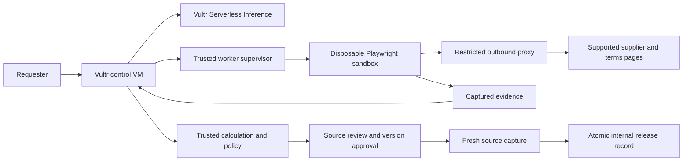

# QuoteProof v2: bounded purchase review and release

Revised November 3, 2026. Canonical plan after [JUDGE_REVIEW.md](JUDGE_REVIEW.md); supersedes [the initial draft](history/v1/BUILD_PLAN.md). Design response: [PRODUCT_REVISION.md](PRODUCT_REVISION.md). This document describes proposed behavior, not a working application.

## Product contract and scope

User hypothesis: an IT deployment coordinator at a small IT services provider buying a complete, specified equipment kit. One purchase request contains three line items, up to three known suppliers, one currency and one supplier per purchase. Output: a versioned internal release record and a source-backed decision packet.

Primary execution: **Blast Radius Zero, Pattern B**. The agent plans supported browser inspection, gathers evidence, proposes fields and identifies contradictions. Trusted code owns all arithmetic, policy, evidence-review states, approval and release. Generated code, a repair loop and a second reference-calculation environment are removed. The official challenge permits either execution pattern. [Organizer playbook](https://lablab.ai/ai-hackathons/vultr-hackathon)

Initial source support: approved public/owned HTML offer pages with at most one supported terms page per offer. No authenticated supplier sessions, CAPTCHAs, arbitrary crawling or general shopping search. Static quote files, OCR, spreadsheets and PDF parsing are deferred. Establish that a real buyer task fits this source boundary before committing to the build; if buyers rely on private attachments, that is a failed workflow-fit assumption, not permission to claim support we do not have.

Limit the commercial rules to exact approved specifications, explicit sell units/MOQ, single currency, explicit shipping, known tax-inclusive treatment and stated lead time. Unknown costs, substitutions or contradictory terms require review. No FX, tax engine, tiered pricing, split orders or assurance of actual stock/delivery. Do not infer availability of 25 units from a generic product page's delivery banner.

Excluded: external supplier orders, payments, ERP/email integrations, negotiations, continuous monitoring, blockchain, model training and enterprise role-management. The internal release records the requester's authority within this application; it does not impersonate a procurement department's actual approval system.

## Buying scenario and trusted rules

[DEMO_SCENARIO.json](DEMO_SCENARIO.json) specifies a synthetic 25-workstation rollout with 25 docks, 25 monitors and 25 compatible cables, $10,000 budget and seven-day limit.

| Supplier | Evaluated offer | Result |
| --- | --- | --- |
| A | $4,950 in monitors/cables; docks expressly excluded | Incomplete; total for required basket unknown, never rank as complete |
| B | All items; cables in packs of ten; four-day lead time | Three cable packs deliver30; total$9,500; candidate after review |
| C | All items; twelve-day lead time | Total$8,960; infeasible for deadline |

For a quoted line, `sell_units = max(minimum_sell_units, ceil(required_units / sell_unit_size))`; delivered units are `sell_units * sell_unit_size`. Multiply integer cents per sell unit, sum complete lines, add explicit shipping. A missing required line makes the complete comparable total null, even if quoted components have a known subtotal. Do not confuse an incomplete offer with a known over-budget offer.

A complete basket is feasible only if every required term is supported/reviewed, exact specifications match, known total fits the budget and stated lead time meets the deadline. Rank only feasible baskets; deterministic supplier ID breaks equal-cost ties. The result is a candidate under captured claims, not a warranty about the supplier.

B source revision b2 raises each dock from$160 to$175. Recomputed total$9,875, increase$375; old approval invalid despite remaining within budget. The source fixture changes behind the browser; internal stored b1 is untouched until recapture.

## Useful model work and authority boundary

The model receives a public item specification and an allowed page-token list. It can choose supported navigation/inspection steps, follow the permitted terms token, request a screenshot, propose field values with source references and draft clarification questions. Browser observations guide later steps. User input cannot become an arbitrary shell command or host path.

A Vultr vision call checks correspondence between proposed terms and captured screenshots. It cannot certify supplier truth or overrule conflicts. All agent calls go through Vultr Serverless Inference, with IDs and actual usage recorded. The November3 [model catalog snapshot](MODEL_CATALOG_SNAPSHOT.json) is discovery metadata only; an authenticated capability/latency test is still required. Initial candidate remains qwen3.8-flash-next, with other listed models tested only if necessary.

Only trusted services can change buyer constraints, mark a reviewed field, approve a version or create a release. These commands are absent from the model tool schema. Browser capture receives no private buyer document, budget, approval, session cookie or inference credential. Use distinct model contexts for public browsing and any private report explanation; never replay the private transcript into a browsing tool.

Readiness cannot be a model-generated boolean. The rules engine derives it from confirmed fields and policy. Explanations display derived values and reasons; generated prose must not replace authoritative numbers.

## Evidence, source identity and review

Per field retain value/unit, source text, screenshot/region, source URL, capture interval, source fingerprint and review status. Material fields: item/specification match, exclusions, quantities, sell units/MOQ, prices, shipping, tax basis and delivery. Store raw snapshot references separately from normalized fields.

States are extracted, buyer_checked, disputed and unknown. Before approval, the requester explicitly reviews critical terms; disputed or unknown material terms block readiness. Preserve original extraction and corrected values, reviewer/time and supporting source. A buyer check is an attribution, not independent proof of truth. Count its effort in the baseline comparison.

Supported adapters capture the full relevant offer and permitted terms page, including exclusions. Fingerprint their deterministic content projection; exclude only known irrelevant chrome. If content changes or a new clause appears, review is required. The model cannot decide a changed source is harmless and silently preserve approval. Screenshot-byte equality is not a semantic freshness mechanism.

Sanitize untrusted content. Do not render supplier HTML under the application origin; serve raster captures through ownership-checked artifact routes. Validate bounded image dimensions/types and escape all supplier/model text. If CSV export is included, neutralize spreadsheet formulas.

## Approval, recapture and release

States: `queued → inspecting → needs_review → ready_for_approval → approved_version → rechecking → released`.

Branches: `incomplete`, `infeasible`, `source_changed`, `source_unavailable`, `failed`, `timed_out`, `cancelled`, `expired`. Changed material request/source/policy fields return to review. An approval is never portable to another version.

Approval binds requester/session, request version, all decision-source versions, normalized fields, policy version and expiry. Initial expiry ten minutes. The release endpoint runs this protocol:

1. Check user ownership and current approved version.
2. Start fresh sandbox capture of all sources used in the comparison, including nonselected suppliers. Capture permitted terms attachments too.
3. On any source-content change, missing evidence or failed fetch, stop. Retain a diff/error; recompute and request new source review/approval as needed. Source unavailability never authorizes reuse of old data for a fresh release.
4. If unchanged, atomically check current request/policy/approval versions, approval expiry and that all necessary captures finished within the last60seconds. Use a server clock and record capture intervals; a slow recheck must be retried rather than weakening the limit.
5. Create one internal release record keyed by approved packet/version. Duplicate clicks return the same record. Concurrent edits cause conflict; never silently overwrite.

Receipt contains request/release IDs, confirmed fields, totals, exception/rejection reasons, source versions/times, review/approval times, recheck interval, policy version and artifact hashes. Export the decision packet from this record. Hashes establish consistency with saved artifacts, not external authenticity or operator-proof auditability.

This controls our internal transition. It cannot reserve stock, lock a supplier price or atomically couple release with a supplier transaction. Clearly label the record as based on captured supplier claims and the last-check time. A stale draft can be exported with a prominent stale label; it must not receive a release receipt or bypass the fresh path.

All-source recapture has a latency/availability cost that must appear in the evaluation. A requester may deliberately exclude an unavailable source by creating and reviewing a new comparison version; neither agent nor backend may omit it silently and reuse the old approval.

## Vultr deployment and containment

Use a trusted Vultr control VM and a separate Vultr worker VM. The control service hosts the frontend/API, durable SQLite job/release state and evidence index; persistent disk stores validated artifacts. The worker supervisor manages disposable browser jobs. Prefer pinned Docker+gVisor images once compatibility is verified. Only one purchase-review job is active until capacity is measured.

Supervisor accepts a fixed job schema and server-selected image/runtime/paths. It is reached only through a private authenticated control channel. Never expose the Docker socket, runtime administration or host credentials to the web app/model/task. Keep infrastructure and inference credentials in trusted services, not sandbox environment variables.

Provisional worker limits: 1.5CPU, 3GiB total job memory with equal memory/swap limit, 256PIDs and90second watchdog per capture stage. Use a non-root task user, dropped capabilities, no-new-privileges, read-only root and bounded writable temporary storage. Budget10MiB accepted output per stage and64KiB retained logs. Record actual limits and memory behavior. A separate browser context per source has no saved authenticated profile; each job is destroyed after use.

External enforcement permits only configured source/terms/asset origins through the proxy. No direct egress, arbitrary DNS/UDP, private/reserved/metadata addresses including IPv6, unapproved redirects/ports or WebSockets. Validate connections after resolution. Browser tools use server-issued URL tokens, not model-written paths, queries or arbitrary form text. An origin allowlist alone does not prevent exfiltration to that origin; absence of private material in capture is essential.

Use appropriate Chromium sandboxing; do not silently add no-sandbox to rescue compatibility. Independently verify metadata/private-network denial, positive approved fetch, bounded CPU/memory/disk, timeout and cleanup. Crash/restart sweeping removes expired jobs; ownership checks stop cross-session access. General controls remain necessary with public content.

The earlier plan's generated-code subsystem is removed, but untrusted pages and browser execution still require containment. gVisor does not replace network/resource/service security. References: [gVisor security](https://gvisor.dev/docs/architecture_guide/security/), [Docker resource controls](https://docs.docker.com/engine/containers/resource_constraints/), [Docker security](https://docs.docker.com/engine/security/).

## Acceptance and evaluation

| Test | Expected evidence |
| --- | --- |
| Base basket | A incomplete/null complete total; B9500 feasible after review; C8960 late; correct cable pack rounding |
| Semantic attack | A exclusion remains visible/recognized or review is required; false-ready output is a failure even if sandbox healthy |
| Critical extraction error | Wrong unit, omitted shipping/tax, substitution or unsupported availability blocks readiness pending source resolution |
| Authority attack | Budget/approval/release proposals rejected independently of model behavior; no release record created |
| Network/resource attack | Metadata denied, hung page stopped, control responsive, fresh job succeeds; no invented events |
| Actual source revision | SourceB changes without internal edit; recheck discoversb2;9875 recomputed; old approval fails |
| Nonselected change / failed recheck | Reevaluate comparison or remain unreleased; do not silently reuse old evidence |
| Concurrency/idempotency | Request edit invalidates in-flight approval; duplicate release yields one internal record |
| Unfamiliar supported inputs | Independent source packet and held-out layout/revision work or abstain with actionable reason; no fixed answer |
| Complete hosted flow | Request→Vultr model→sandbox evidence→critical review→approval→recapture→release/export works without shell access |

Build a small evaluation set covering omission, packs/MOQ, price changes, delivery, unknown tax/shipping, contradictions, no feasible supplier, stale/unavailable sources and attacks. Expected terms must be independently checked before testing. Repeats assess consistency, not new-example coverage; retain all failures and separate held-out cases from development inputs.

Metrics: critical-field errors; false-ready/wrong-selection rate; useful completion and abstention; buyer review/correction time; total task time; latency; cost; policy denials and cleanup. Aggregate field accuracy is supplementary. Gate release on zero known unblocked critical errors in the finite supported suite while completing useful tasks. No universal safety/generalization claim.

Baseline: actual manual source review+spreadsheet, and if practical model extraction+the same deterministic calculator. Same supported inputs, constraints and ordinary review. Count setup, correction, recapture and release effort. Value gate: observed effort improves without new critical errors, or a consequential baseline error is caught with acceptable added effort agreed before testing. If neither occurs, reconsider direction.

## Six-day allocation and cut lines

Assume48focused hours across Nov3–8; this is a delivery budget, not measured velocity. Internal ready target remains Nov8 18:00UTC/19:00 Lagos; confirm current form/deadline and remote prize eligibility.

| Day | Focus within8hours | Gate |
| --- | --- | --- |
| Nov3 | 2h source/buyer-task feasibility;3h Vultr model/image+isolated browser spike;2h basic deployed request/status;1h frozen schema | At least one plausible independent supported task; actual browser/model/cleanup evidence before full commitment |
| Nov4 | 3h bounded capture/egress;2h fields/evidence UI;2h deterministic basket rules;1h fixture terms | Base basket and meaningful uncertainty/review behavior |
| Nov5 | 3h review/approval;2h source recapture/diff;2h atomic release/idempotency;1h full journey | Source revision detected without internal edits; no stale release |
| Nov6 | 3h adversarial/ownership/recovery;2h independent source/held-out cases;2h buyer task evaluation if available;1h fixes | Separate meaning/authority/resource outcomes and honest value evidence |
| Nov7 | 3h deployed evaluation;2h README/slides;2h real video;1h fixes | Public supported flow and measured results; all limits explicit |
| Nov8 | 2h remaining defects;2h clean setup/mobile checks;2h final media/form materials;2h buffer | Completed reviewable submission package before internal deadline |

First source-feasibility gate is substantive: if real buyers require formats/login the MVP cannot support, revise scope/segment before spending days on a polished fixture. If model adds no benefit, do not retain it only for appearance. If release rechecking cannot be completed, ship a clearly scoped captured-term review tool and downgrade the competitive assessment; do not claim the core change-control benefit.

Do not add PDF/OCR, email, ERP, multiple roles or external write actions to rescue a weak value story. Keep required isolation and policy. A second engineer, if available, could own capture/containment while the first owns review/release; this is a staffing option, not a request to spawn agents.

## Spending and presentation

Keep the previous **$100 planning ceiling**: up to$30compute, $20inference, $10storage/network, $40contingency. Compute rates and credit coverage remain unverified assumptions; check actual plans before provisioning. Model text-price metadata excludes uncertain image/reasoning/retry charges. Cap job steps and anonymous usage, record actual cost, and plan demo retention after the event. No resources have been provisioned.

Video target3:30–4:00 unless the actual form sets another limit. Show buyer/kit; incomplete/late offers and source evidence; correct B basket; meaningful semantic/authority/timeout evidence; approveB; change the supplier source; recheck blocks stale approval; review9875 and produce internal receipt. Conclude with actual evaluation/limitations and compact Vultr architecture. Label synthetic offers and any removed waiting time. Never show fabricated attacks or replayed results as live.

Map technology to actual bounded inspection and release enforcement, presentation to one clear operational decision, business value to measured task evidence, originality to demonstrated behavior against a baseline. No first-ever, guaranteed-savings or zero-risk claims. Public README must explain source limits, model/Vultr use, runtime, containment, release semantics, setup and measured evaluation. Prepare public repository/demo, real video, PDF slides and accurate form fields. User-owned eligibility/terms/final submission remain outside this planning revision.
