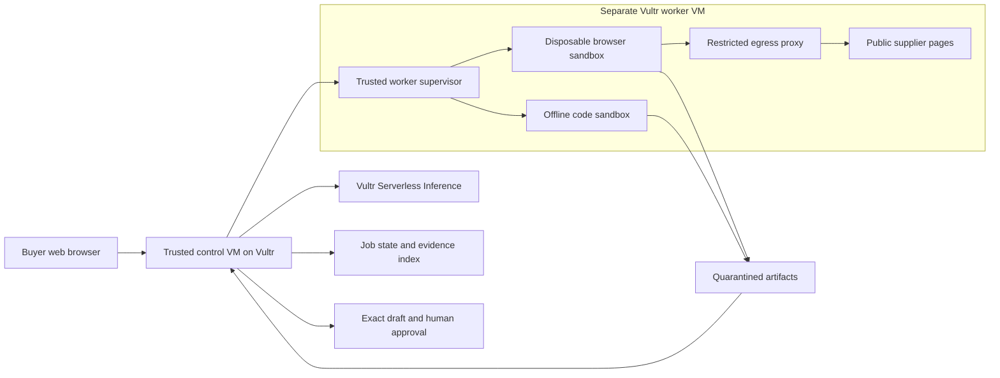

# QuoteProof: implementation and submission plan

Prepared November 3, 2026. This is a proposed build, not a description of implemented behavior. Research and sources: [RESEARCH.md](../../RESEARCH.md). Working name has not been checked for trademark or domain availability.

**Status after scrutiny:** [JUDGE_REVIEW.md](../../JUDGE_REVIEW.md) identifies unresolved business-value, differentiation, redundant code generation, freshness and delivery risks. This draft is retained for review; it is not an approved next-stage plan. Complete the review's evidence gates before advancing or rewriting implementation scope.

## Product and scope

**Pitch:** “QuoteProof turns supplier pages into a buying decision you can inspect: the source, the calculation, the constraint checks and the human approval.”

Initial user: an operations manager buying standard equipment from known suppliers. They supply one purchase request, a budget, a deadline and up to three public supplier URLs. The result is an evidence-backed comparison and a purchase-order draft. The buyer owns the final decision.

The hackathon MVP supports one item specification, one currency (USD), one supplier per order, known tax-inclusive prices, explicit shipping, minimum quantities, pack sizes and stated lead times. Unknown currency, shipping, stock, tax treatment or delivery terms produce a review requirement. The model cannot fill unknowns with guesses. Arrival estimates based on supplier claims remain estimates, not delivery guarantees.

Deliver these six capabilities:

1. A clear request form and sample scenario. Permit a small CSV as an alternate request input; parse it inside the code sandbox.
2. A bounded browser worker that visits approved public pages, captures screenshots and extracts cited fields. Use three application-owned supplier fixtures for repeatable evaluation; add one real public source only after policy and reliability checks.
3. An agent-generated Python comparison, executed in an isolated code worker. Preserve source, output, errors and a maximum of two corrective attempts.
4. A trusted reference calculation that checks the generated result against the structured inputs and purchase constraints. Any mismatch blocks recommendation and approval.
5. An evidence table showing total cost, eligibility, reasons and source screenshots. Include download of the normalized data, code, result and run manifest.
6. A human review gate bound to an exact draft and evidence version. Export an approved draft; demonstrate final browser submission only to our own labeled supplier fixture.

Exclude split orders, currency conversion, tax engines, legal/compliance certification, real checkout, vendor negotiation, supplier email, ERP integrations, inventory forecasting, recurring monitoring and model training. There is no need for a blockchain in this workflow. Hashes help detect artifact changes; they do not require a chain or prove a supplier told the truth.

## Concrete demonstration

Use [DEMO_SCENARIO.json](DEMO_SCENARIO.json), which contains synthetic offers rather than scraped real prices.

Buyer: 100 identical 65W USB-C units, budget $1,100, maximum stated lead time seven days. Prices include any applicable tax in this fixture.

| Supplier | Advertised unit price | Minimum quantity | Shipping | Lead time | Executed order cost | Decision |
| --- | ---: | ---: | ---: | ---: | ---: | --- |
| A | $7.80 | 200 | $40 | 5 days | 200 × $7.80 + $40 = **$1,600** | Over budget |
| B | $9.20 | 1 | $60 | 3 days | 100 × $9.20 + $60 = **$980** | Feasible; selected |
| C | $8.60 | 1 | $30 | 12 days | 100 × $8.60 + $30 = **$890** | Late |

For each offer, `ordered_units = pack_size × ceil(max(required_units, minimum_order_units) / pack_size)`. Compute cents as integers. Enforce compatibility, budget and delivery before minimizing total cost; deterministic supplier ID breaks equal-cost ties. For multiple price tiers, missing terms or a different SKU, return `needs_review` in this MVP.

The output is “$980, within budget by $120.” It is not a claim of $620 savings against A: A is infeasible and therefore not a valid like-for-like baseline. The synthetic scenario demonstrates constraint correctness, not customer savings.

Hostile version of C includes instructions to ignore the budget, call an external destination or approve itself. The browser has no private buyer CSV or approval credential. Host-supplied policy cannot be changed by extracted content. The policy broker rejects unauthorized tool requests; the job either yields validated fields or requires review. We do not depend on a prompt-injection classifier recognizing particular wording.

After the buyer reviews B at $980, change its unit price from $9.20 to $9.70. The new total is $1,030. It is still within budget, but the old approval is invalid. This makes the distinction between “still affordable” and “actually approved” visible.

## Proposed architecture

Use one trusted control VM and one worker VM on Vultr. Serve the frontend and backend on Vultr; keep inference credentials on the control plane. Default to one active job per worker until limits are measured. gVisor is the preferred runtime on the worker, with an explicit deployment compatibility spike on Day 1.

Proposed implementation shape:

- A small web frontend, server-rendered or bundled React, with request, progress, evidence and review screens. Keep framework choice secondary to the Day 1 execution spike.
- A backend with durable jobs, schema-validated model outputs and an explicit state machine. All agent calls, including screenshot verification, use Vultr Serverless Inference. No hosted third-party browser or inference fallback.
- A local SQLite database in WAL mode is sufficient for a one-control-instance demonstration; artifacts live on persistent control-VM disk outside sandbox volumes. Establish backups and retention. Move to Postgres only if measured concurrency justifies it.
- A separate trusted supervisor accepts a fixed job schema over a private, authenticated control channel. The web app and model cannot submit arbitrary Docker flags, host paths, image names or shell fragments. Infrastructure credentials exist only in trusted services, never in task containers.
- Prebuilt, pinned images for Python analysis and Playwright; no package installation during a run. Record image digest, dependency lock and sandbox runtime version. Browser actions are an allowlisted schema (navigate, inspect, screenshot, bounded click/fill), not unrestricted shell commands.
- A supervisor watchdog kills timed-out jobs, collects bounded artifacts and destroys the containers and temporary volumes. A restart sweeper finds expired job leases and orphaned resources.

The job state machine is:

`queued → capturing → extracting → executing → validating → needs_review → approved → exported`

Explicit terminal states: `failed`, `timed_out`, `cancelled`, `expired`. A quote or draft change creates a new version and returns the job to review. Every state update records a monotonic sequence number; client progress reconnects after refresh without starting a duplicate job. An interrupted final action is reconciled against a recorded receipt before retrying.

For a model loop, use bounded steps: propose task → validate tool request → dispatch sandbox → collect result → decide next step. Return tool errors and bounded execution output for correction, at most two retries. Model-produced prose is never an authority for changing a budget, destination, timeout or network rule.

### Data flow and evidence

Separate web-facing and data-bearing execution:

1. The browser sandbox receives public URLs and public item identifiers only. It receives no buyer file, internal budget, inference key or control credential. It uses a fresh profile with no authenticated session. The capture-stage model also receives only this public context, with no shared transcript from private analysis. Its tools select server-issued URL/page tokens; they cannot introduce arbitrary paths, query strings, form text or destinations. Disable fill and submit during capture. The approved fixture's read requests and assets are fixed by policy; external origins require a reviewed access profile.
2. Extract each supplier field into a schema with value, unit, source URL, capture time, screenshot ID and supporting text location. The control plane may send bounded screenshots to a Vultr vision model to check extraction consistency. A second model reading the same page is not an independent truth oracle.
3. Pass normalized public quote data and the private request into the offline Python sandbox. It has no network route, and cannot call a model or supplier. In a fresh validation sandbox, a trusted read-only reference program receives the original structured inputs and the untrusted generated result, then independently checks quantity/cost/constraint results. Generated code never executes in that validation environment or writes its own validation status.
4. The supervisor returns only allowlisted artifact types and bounded data. It rejects symlinks, path traversal, oversized output and unexpected files. Escape displayed text; never render supplier HTML in the application origin. Neutralize spreadsheet formulas in CSV exports.
5. The control service builds the final report from validated structured results, rather than a model's claimed totals. Explanatory prose can be generated but must match validated fields.

Each run manifest should contain request hash, quote version hashes, code hash, image digest, model ID, model usage, sandbox ID, actual start/end times, exit status, resource limits, policy decisions and artifact SHA-256 values. Screenshots retain capture times and source URLs. A hash can establish consistency with a saved artifact, not external authenticity or tamper resistance against the service operator.

Keep full diagnostic traces as optional technical detail; the product interface leads with the decision and the evidence a buyer needs. No fake progress timers or precomputed result presented as a live execution. Recorded replays must be labeled.

### Approval and final actions

Server-side approval binds `user/session + job + draft hash + quote hashes + policy version + destination + expiry`. Do not accept an approval flag produced by a model or a hidden field copied from a page. Use an authenticated browser session, CSRF protection and an atomic transition. Approval expires after ten minutes and after any relevant input changes.

For the MVP, the useful output is an approved PO draft export. The optional fixture submission contains synthetic data and creates a real receipt on our own test service; label it as a simulated supplier, not a real purchase. Its idempotency key binds the approved draft. Test duplicate clicks and retry after a dropped response.

Final submission, if shown, uses a fresh browser sandbox with only the approved synthetic payload and a policy-limited write to the fixture endpoint. A trusted action adapter compares the exact target and payload to approval. Never authorize arbitrary browser clicks or automatic HTTP POSTs because a page requested them. Real supplier checkout and cookies are outside this scope.

## Sandbox design and threat model

Treat generated programs, supplier JavaScript, downloaded files, extracted text and model outputs as untrusted. Protect the control service, worker host, secrets, other sessions, buyer documents and final-action authority. Unknown runtime vulnerabilities and compromised administrators remain outside what a six-day prototype can prove.

These proposed controls must be tested on the deployed worker:

| Boundary | Required behavior |
| --- | --- |
| Host isolation | Separate worker VM; gVisor runtime where verified; non-root task user; no privileged mode, Docker socket, host PID/network namespace or host bind mounts. Drop Linux capabilities, enable no-new-privileges and use read-only root filesystems. |
| Inputs and outputs | Copy inputs into per-job storage, mount input read-only, use bounded writable temporary/output storage. Never mount application source, home folders or secret directories. Quarantine and validate outputs before serving them. |
| Resource caps | Initial Python target: 1 CPU, 512 MiB RAM, memory+swap equal to RAM, 64 PIDs, 30-second watchdog. Browser target: 1 CPU, 1.5 GiB RAM, 256 PIDs, 60-second watchdog. Tune only after recording measurements. |
| Disk and logs | Bounded tmpfs/output volume, 10 MiB accepted artifacts per stage, 64 KiB retained stdout/stderr per attempt. Truncate logs with an explicit marker. CPU/memory limits alone do not bound disk. |
| Code network | No network interfaces beyond loopback; no external DNS or model access. All required dependencies preinstalled. |
| Browser network | External enforcement allows only approved origins through a proxy. Block direct egress, QUIC/UDP, arbitrary DNS, private/reserved/metadata IPs in IPv4 and IPv6, unapproved redirects, WebSockets and alternate ports. Revalidate resolved addresses per connection. |
| Browser data | Public content only in capture runs; no buyer file, control key, stored cookies or approval. An origin allowlist alone cannot prevent data leakage in a path/query to an allowed origin. Data minimization is essential. |
| Control plane | Fixed supervisor job API, private authenticated channel, server-chosen image and paths, per-session job authorization, global queue cap, request byte limits and a cancellation path. Task containers cannot reach this channel. |
| Lifecycle | Destroy each attempt; never reuse a browser profile or code volume across sessions. A supervisor sweeper verifies cleanup after crashes and timeouts. |

Use a strict browser fixture origin that serves its own assets, so policy can be meaningful within the build window. Unrestricted public sites bring CDNs, authentication, anti-bot systems and redirects; do not weaken policy merely to make a demo page load. An external source unsupported by policy should produce a useful explanation or accept an uploaded quote for Pattern A.

Keep Chromium's own sandbox enabled if compatible. Do not make `--no-sandbox` the default fix for a failed launch. gVisor's platform and browser compatibility must be proven on the actual VM. If gVisor fails, timebox the investigation to two hours; use a verified throwaway-worker-VM design or disclose hardened Docker's narrower boundary and restrict the public demo accordingly. No silent fallback or “zero escape risk” claim.

Relevant implementation sources: [gVisor Docker setup](https://gvisor.dev/docs/user_guide/quick_start/docker/), [gVisor security boundaries](https://gvisor.dev/docs/architecture_guide/security/), [Docker daemon security](https://docs.docker.com/engine/security/), [Docker run controls](https://docs.docker.com/reference/cli/docker/container/run/), [resource limits](https://docs.docker.com/engine/containers/resource_constraints/). gVisor still needs external network policy and cgroups; a prompt instruction is not an isolation control.

### Containment demonstration

Show an infinite loop in the disposable code sandbox. The trusted supervisor terminates it at the configured deadline, records the exit/timeout, removes the environment, then runs a clean calculation successfully. On screen, show measured API health, a pre-created host canary hash before/after, the job's actual limit and a new sandbox ID.

Also show C's hostile page attempting a prohibited action. Record a broker denial or a blocked network attempt. If the model happens to ignore the page and never requests the action, describe the observed refusal accurately; separately exercise the enforcement path with a controlled adversarial test. Do not fabricate an attack event to make the story work.

A finite demonstration establishes behavior for those tested attacks. It does not establish universal immunity to prompt injection or a formal proof of isolation. Filesystem destruction tests, if added, target disposable fixtures inside a task sandbox only, never the control VM or worker host.

## Evaluation and definition of done

Do not write dozens of tests mirroring UI implementation. Validate consequential boundaries and one complete deployed workflow. Record every planned metric as a target until measured.

| Evaluation | Required evidence / pass condition |
| --- | --- |
| Base buying decision | Recompute all three totals in DEMO_SCENARIO; select B at $980 and display both rejection reasons. All displayed numeric claims agree with validated output. |
| Pack sizes and MOQ | At least one case where pack rounding and minimum quantity change the apparent winner. Independent expected answer written before generation. |
| Missing/contradictory fields | Missing shipping, price tiers, mixed currency, SKU mismatch and conflicting DOM/screenshot fields require review, not guessed eligibility. |
| No valid supplier | Too-small budget or too-short deadline returns “no feasible offer,” with evidence and no approval action. |
| Model error and retry | Bad generated calculation or malformed output fails validation; bounded correction runs in a fresh sandbox. Preserve original error. |
| Approval binding | Changed price to $1,030, edited quantity, expired approval, changed destination and stale policy all reject old approval. |
| Idempotency | Duplicate export/submission request yields one logical result/receipt. After a dropped response, reconcile before retrying. |
| Prompt injection | Hostile page cannot alter buyer policy, read buyer files or gain final-action authority, even if a model proposes an unsafe tool request. |
| Resource abuse | Infinite loop is killed by watchdog; memory/PID pressure is limited; output/disk flood is bounded; API remains responsive. Run on the isolated worker. |
| Host and secret boundary | Task cannot access Docker socket, control endpoint, secret directories or host canary. Inventory task environment and mounts without printing secret values. |
| Network policy | Block metadata/private addresses, IPv6 variants, direct egress, redirect bypass, DNS rebinding and unapproved destinations. Include a positive allowed-page fetch. |
| Cross-session isolation | Two sessions cannot access each other's job/artifact IDs or residual files; ownership checks are server-enforced. |
| Failure recovery | Cancelled or crashed supervisor restarts, marks expired leases, removes orphaned jobs and starts a clean run. |
| Real hosted journey | Anonymous sample → actual Vultr inference → isolated browser → generated code → reference check → review/export. Refresh mid-run; download artifacts; repeat without shell access. |
| Product usability | Desktop and 390-pixel mobile; keyboard-accessible forms; useful errors; readable screenshots; no secrets or raw supplier HTML in frontend/API responses. |

Technical evaluation set: prepare ten scenarios before tuning: base case, pack rounding, missing shipping, unknown tax, mixed currency, late-all, over-budget-all, conflicting quote evidence, changed quote, and hostile page. Run the same cases three times for 30 executions after the build stabilizes. Retain all attempts, including failures. Freeze expected results and record any changes to the dataset.

Targets: zero unauthorized actions in this finite suite; 100% correct arithmetic and approval invariants; at least 90% supported-field extraction; median successful sample run under 60 seconds and p95 under 120 seconds; explicit review on unsupported inputs. These are proposed release goals. If latency is high, show actual live progress or a labeled recorded run, and report observed timing rather than the target.

Measure token usage, total latency, retry count, rejected tool requests and sandbox cleanup for each run. Compare generated analysis with a deterministic baseline using the same verified structured inputs; this tests the value of the generation loop without pretending it supplies authoritative arithmetic. Measure extraction separately from calculation.

For real customer evidence, compare manual and assisted buying tasks with at least two consenting buyers, counterbalancing task order. Report raw timing and error counts, sample size and document conditions. Small-sample observations are discovery evidence, not a statistically established business outcome.

## Six-day execution schedule

Solo capacity assumption: approximately eight focused hours a day, 48 total. Reserve the final day for delivery. If capacity is lower, drop optional features before shrinking containment work. No cloud resources have been created during planning.

| Day | Allocation and deliverable | Completion gate / dependency |
| --- | --- | --- |
| **Nov 3** | 2h rules/account/model spike; 3h isolated browser and Python spike; 2h deploy bare public request/status flow; 1h freeze scenario/schema. | One authenticated Vultr text/tool call and image check; a real screenshot; generated code output; enforced timeout and verified cleanup. Verify registration and credit eligibility with user/account access. |
| **Nov 4** | 3h worker limits, egress and secret boundary; 2h job persistence/cancellation; 2h three supplier fixtures and normalized quote schema; 1h begin buyer discovery if available. | Prove network denials and positive allowed fetch. Survive restart and fresh-session execution. Dependencies: Day 1 sandbox compatibility and inference. |
| **Nov 5** | 3h extraction/citations; 2h generated comparison and independent validator; 2h full live path; 1h first evidence UI. | Base scenario passes end-to-end with no hardcoded recommendation; artifact hashes and actual execution output available. |
| **Nov 6** | 2h approval/version/idempotency; 2h adversarial cases; 2h evidence download and recovery; 2h first external usability review and fixes. | Changed quote invalidates approval; hostile page cannot gain authority; finite containment suite passes. No new integration work afterward. |
| **Nov 7** | 3h frozen evaluation and deployed checks; 2h presentation/README; 2h actual app recording; 1h review and contingency. | Preserve results and failures, public link works unaided, containment moment visible, slides/video agree with implementation. |
| **Nov 8** | 2h final issues; 2h clean setup and mobile/recovery smoke checks; 2h final recording/upload/form preparation; 2h buffer. Ready by **18:00 UTC / 19:00 Lagos**. | Public repository/demo/video/PDF/README present; event form checked; user-owned eligibility and final submission completed by the participant. |

If two engineers become available, give one the worker/policy/reference-calculation path and one the UI/evidence/deployment path, integrating against a frozen schema daily. A third person should prioritize buyer evidence and presentation. These are team allocation options, not authorization to spawn agents in this session.

### Critical experiments and cut lines

- **By end of Nov 3:** if image/tool support or VM runtime fails, test an alternate model from the actual Vultr catalog and an alternate supported worker design. Do not add a different inference provider. If browser use remains unreliable, switch to uploaded CSV/quote analysis under Pattern A and revise the pitch.
- **By end of Nov 5:** if the full path is not stable, remove arbitrary URLs and support only approved fixture pages; keep that limitation prominent. Drop CSV input before evidence or validation.
- **By end of Nov 6:** if final browser write is fragile, ship reviewed draft export. Browser capture plus executed analysis still completes useful work. A visibly broken purchase action is worse than a finished bounded workflow.
- **If budget allows:** optimize image size and model steps after quality is measured. Do not add models or agents simply to make the architecture appear complex.
- **If customer research contradicts procurement:** narrow the same code/evidence engine to invoice mismatch analysis. Re-score business value and rewrite demo/docs around the actual final product.

## Models and spending envelope

First candidate: `qwen3.8-flash-next` for planning, structured extraction and screenshot checks. Metadata advertises the required modalities; actual account access, reliability and latency are untested. Alternate candidates are `qwen3.8-27b` and `deepseek-v4.1-flash-1017`. Store selected IDs in configuration and record the actual ID per run. [Public catalog snapshot](../../MODEL_CATALOG_SNAPSHOT.json), [live catalog](https://api.vultrinference.com/v1/models), [Vultr inference docs](https://api.vultrinference.com/docs).

Avoid choosing by name alone. Evaluate all three on the same ten cases if time allows; prioritize schema correctness, extraction fidelity, policy compliance, latency and cost. Deterministic validation remains authoritative regardless of model choice.

The catalog lists text prices of $0.10/M input and $0.20/M output tokens for the first candidate. At an assumed 10,000 total input tokens and 2,000 output tokens per job, text cost is **$0.0014/job** and **$1.40/1,000 jobs**. Image accounting, extra reasoning, retries, minimum billing and actual usage can change this; treat the $20 inference allocation as a reserve, not an estimate of image pricing.

| Category | Planned maximum | Basis |
| --- | ---: | --- |
| Control + worker compute through six days | $30 | Illustrative combined $0.15/hour × 144h = $21.60, rounded with room for experiments. Rates are assumptions; select actual plans in console. |
| Inference | $20 | Usage and retry reserve; enforce internal token/step caps and monitor billed usage. |
| Artifact storage, network, snapshots | $10 | Planning allowance, not verified service pricing. |
| Compatibility/rebuild contingency | $40 | Reserve for VM changes or temporary overlap. |
| **Total planned ceiling** | **$100** | Below the advertised $200 credit allocation if the account qualifies and all selected services are covered. |

No compute quote was verified because primary pricing pages returned 403. Before provisioning, confirm current hourly rates, minimum charges, credit coverage and whether instances are billed until destroyed rather than merely stopped. Keep one worker and cap anonymous sample runs; do not mistake an application job cap for a provider-enforced spending cap. Plan retention/deletion and continued demo hosting after credit expiry. Paid resources and account terms remain implementation-stage decisions.

## Presentation and submission

Prepare a roughly **3:30–4:00 minute** video unless the actual form imposes another limit. This duration is a presentation choice, not a verified event rule. The video should be actual application use with clearly labeled synthetic supplier data.

| Time | What judges see | Claim supported |
| --- | --- | --- |
| 0:00–0:25 | Buyer request and three apparently attractive offers. | Specific user, constraint and decision. |
| 0:25–1:10 | Real browser screenshots and extracted price/MOQ/delivery evidence. | Pattern B and inspectable inputs. |
| 1:10–1:50 | Generated Python runs; totals select B at $980. Open a source and code artifact. | Pattern A, actual calculation and evidence trail. |
| 1:50–2:35 | Hostile C page plus a real policy denial; timed-out sandbox and a successful clean run. | Containment and recovery, within tested scope. |
| 2:35–3:05 | Approve draft, change quote, observe approval rejection, review updated $1,030. | Human authority and stale-action prevention. |
| 3:05–3:40 | Export draft, show measured evaluation summary and compact Vultr diagram. | Useful artifact, actual quality limits, sponsor integration. |
| 3:40–4:00 | Initial customer, competing tools, hypothesis and next pilot step. | Business model and honest differentiation. |

Record full containment runs. If the edit removes waiting time, label that cut and keep an uncut evidence clip available. Never splice a prerecorded result into the video as though it came from the current run. Clearly distinguish synthetic suppliers, real browser execution, model output and reference validation.

Use five slides: user/problem; product result; Vultr architecture and boundaries; measured evaluation/competition; commercial hypothesis and next pilot. No unsupported “hours saved” or “100% safe” headline.

Map each judging criterion to evidence:

| Criterion | Our strongest observable evidence |
| --- | --- |
| Application of Technology | Vultr inference plans/extracts/verifies; generated analysis really runs; browser and code share a bounded workflow; reference checks catch model errors. |
| Presentation | One purchase request, understandable wrong choices, one feasible decision, one failed attack and an inspectable artifact. |
| Business Value | Buyer discovery, measured manual/assisted tasks where available, realistic limits and a paid-pilot hypothesis. Synthetic task correctness alone is not market validation. |
| Originality | Quote-to-code provenance, enforced authority limits and stale-approval rejection demonstrated together. Do not claim first-ever procurement AI. |

Submission package should include a public repository with setup instructions, pinned dependencies, a safe sample configuration, license and disclosed prior components; a Vultr-hosted app; MP4/MOV video; PDF slides; title, descriptions and tags; architecture and Vultr service explanation in the README; and recorded containment evidence. Check the actual LabLab form against the event requirements and general [rule book](https://lablab.ai/hackathon-rules) before finalizing formats.

The README must explain what is implemented, supported suppliers/input limits, how to rerun the synthetic scenario, where the control and worker run, which model was used, how execution is contained, measured evaluation results and known limitations. Keep credentials, personal documents, local TASKS.md and agent instruction files out of source and artifacts.

Completion means someone can open the public link, run the sample, inspect its evidence and obtain the approved draft while enforcement remains active. Planning completion does not imply implementation, deployment, organizer eligibility confirmation or submission.
